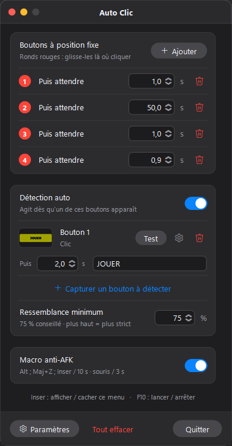

# Auto Clic

Cliqueur automatique pour Windows 10 / 11 : boutons à position fixe, détection de boutons à l'écran
(image et texte), macro de touches, alertes et télécommande sur téléphone. Interface façon macOS.

- Mode d'emploi : [LISEZ-MOI.txt](LISEZ-MOI.txt)
- Audit et améliorations possibles : [AUDIT.md](AUDIT.md)
- Code 2.6.0 (C#, .NET Framework 4.8) : `src/` ; ancienne version PowerShell : `v1/`

## Compiler

Il faut le SDK .NET et le kit Windows SDK 10 (pour la lecture de texte) :

    powershell -ExecutionPolicy Bypass -File build.ps1

`dist\AutoClic\` contient l'édition perso (configs de `src/presets/`), `dist\client\` l'édition sans config.